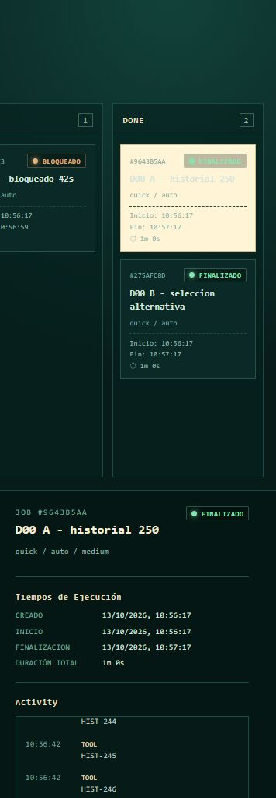

# [ORQUEST][AGENTE C][D00][ESTADO: ENTREGADO]

Actualizado: 2026-10-13 (America/Caracas). Alcance final: V02 en
`ActivityPanel`, los recorridos V03–V05/V07, la propagación del corte SSE del
proxy Vite, regresiones y consolidación de evidencia D00.
Se usaron únicamente el fixture fake, base aislada y loopback `127.0.0.1:4417`
y `127.0.0.1:4418`; no se inició Antigravity, daemon personal ni sesiones Codex
reales. El implementador entregó para revisión; el orquestador aceptó D00 el
2026-10-13 según el cierre de revisión al final. No se inició D01.

## Resultado y causa

Al pulsar «Mostrar eventos anteriores» desde la última página, el componente
esperaba la respuesta REST antes de asignar `visibleAnchorSequence`. Durante
esa espera, el ancla seguía nula y la llegada de SSE mantenía la vista en la
última página, desplazando la lectura del usuario. El test previo solo añadía
eventos LIVE después de resolver la petición anterior, por lo que no ejercitaba
la carrera.

`ActivityPanel` ahora fija sincrónicamente la primera secuencia cargada y
desactiva el seguimiento al fondo antes de solicitar la página anterior. Cuando
la respuesta llega, sustituye el ancla temporal por la primera secuencia de esa
página. Esto conserva la página ya visible durante la petición, sin alterar la
navegación de diez elementos ni el retorno hacia recientes.

Archivos propios modificados:

- [activity-panel.tsx](../../apps/dashboard/src/activity-panel.tsx)
- [activity-panel.test.tsx](../../apps/dashboard/src/activity-panel.test.tsx)
- [vite.config.ts](../../apps/dashboard/vite.config.ts)
- [vite.acceptance.config.ts](../../apps/dashboard/vite.acceptance.config.ts)
- [api.test.ts](../../apps/dashboard/src/api.test.ts)
- [d00-acceptance.ts](../../apps/dashboard/fixtures/d00-acceptance.ts)
- [observaciones de navegador](../evidence/D00/2026-10-09-browser-observations.md)

La prueba nueva `anchors the current page while an older-page request is still
pending` falló antes de la corrección: con la petición diferida, LIVE 21–30
reemplazaba 11–20. Tras el cambio, preserva 11–20, resuelve 1–10 y mantiene diez
elementos. El test existente de retorno al presente verifica que el siguiente
LIVE se sigue de nuevo al alcanzar la última página.

## Matriz consolidada

| Caso | Estado | Evidencia y observación |
| --- | --- | --- |
| V01 paginación | **PASÓ** | Evidencia histórica: A recorrió HIST-001–250 con diez `li` visibles. Tras la corrección, Chrome volvió a mostrar HIST-241–250, una página anterior y siguiente, siempre con diez elementos. |
| V02 vivo/histórico | **PASÓ** | Fixture `D00:controlled`: 12 LIVE, pausa de 30 s y 12 LIVE posteriores. Chrome abrió la página histórica `created`, `queued`, `started`, LIVE-001–007; tras 1 s era idéntica y seguía en diez `li`. «Mostrar eventos más recientes» volvió a LIVE-003–012; tras la pausa el panel siguió LIVE-016–024 y `completed`, de nuevo con diez `li`. |
| V03 reconexión | **PASÓ, revalidado** | Sin reiniciar el daemon ni detener el productor: el proxy de aceptación cortó una sola respuesta SSE downstream. El último panel LIVE previo fue 044–053; durante `RECONNECTING`, REST confirmó producción hasta LIVE-055; tras reconectar, ActivityPanel mostró 048–057. El historial LIVE-001–057 tuvo cero huecos y duplicados (`v03-active-producer-reconnecting.png`, `v03-active-producer-recovered.png`). Las capturas Offline y de reinicio anteriores se preservan como parciales/históricas. |
| V04 carga inicial interrumpida | **PASÓ, revalidado** | CDP mantuvo pendientes dos solicitudes `events` para la misma tarjeta y vista Logs (`loading=true`), las falló y mostró `Failed to fetch / REINTENTAR` sin loader. Al restaurar la red y pulsar Reintentar, la misma vista cargó ocho eventos (`v04-pending-load.png`, `v04-interrupted-pending-load.png`, `v04-recovered-same-view.png`). La evidencia manual anterior se preserva como parcial. |
| V05 cambio rápido | **PASÓ** | Con Slow 3G se seleccionó A y enseguida B. En Logs quedó seleccionado `D00 B - selección alternativa`; se renderizaron `ALT-001`–`ALT-010`, sin `HIST` (`v05-rapid-switch-b-only.png`). |
| V06 novedad y F5 | **PASÓ, histórico** | `NUEVO` persistió antes de seleccionar y desapareció tras seleccionar y recargar; A no fue marcado por cargar historial. |
| V07 error recuperable | **PASÓ** | Chrome aislado aplicó el mecanismo CDP de DevTools para bloquear `*://127.0.0.1:4418/api/jobs/*/events*`. Hubo dos fallos de red, `Failed to fetch` y `REINTENTAR`; al quitar la regla, cargó exactamente HIST-241–250, sin loader permanente (`v07-blocked-events.png`, `v07-recovered-events.png`). |
| V08 duración BLOCKED | **PASÓ, revalidado** | C muestra 42 s y `Última parada` en tarjeta y detalle tras la corrección. |

Detalles, mediciones de solo lectura y la limitación de exportar capturas están
en [2026-10-09-browser-observations.md](../evidence/D00/2026-10-09-browser-observations.md).
CUA emitió capturas en la sesión, pero su API no devolvió ruta de archivo y su
exportador solo admite assets de página; no se presentan las mediciones como
sustituto de una captura portable.

## Fixture controlado y recorridos de red

El fixture de aceptación reconoce `task: D00:controlled` solo dentro de
`apps/dashboard/fixtures/d00-acceptance.ts`: emite 12 eventos con intervalo de
500 ms, pausa 30 s y emite los 12 restantes. `task: D00:long-live` emite 360
eventos cada 500 ms (aprox. tres minutos) para interrumpir un stream aún activo
en V03. Para la revalidación, `ORQUEST_D00_STATE_ROOT` y
`ORQUEST_D00_TOKEN` permiten reiniciar únicamente este fixture conservando su
estado y credencial efímera. No modifica el dashboard, daemon ni perfiles de
producción.

Para la revisión V03 del 2026-10-13, el proxy de aceptación admite
`ORQUEST_ACCEPTANCE_INTERRUPT_FIRST_SSE_AFTER_MS`: corta solo la primera
respuesta SSE downstream. El daemon y el runner siguen activos, por lo que el
productor continúa emitiendo durante el corte. Es exclusivo de la configuración
de aceptación; no está presente en el proxy de desarrollo normal.

El primer intento manual V03 con Offline no era concluyente: Chrome mantiene
conectado el tráfico loopback en esa emulación. El posterior reinicio del daemon
confirmó la presentación de estados pero no conservó el productor activo, por
lo que se conserva solo como evidencia parcial. La revalidación final cortó el
SSE downstream sin reiniciar el daemon. CDP pausó y falló solicitudes pendientes
para V04, y aplicó el filtro de bloqueo de URL para V07.

## Verificación

```text
npm.cmd test -- --project dashboard apps/dashboard/src/activity-panel.test.tsx
  antes de corregir -> exit 1; 1 fallo de regresión esperado / 12 tests
  después de corregir -> exit 0; 12 tests
npm.cmd test -- --project dashboard apps/dashboard/src/api.test.ts
  -> exit 1; ese proyecto solo incluye *.test.tsx, sin pruebas ejecutadas
npm.cmd test -- apps/dashboard/src/api.test.ts -> exit 0; 8 tests
npm.cmd run typecheck                            -> exit 0
npm.cmd run lint                                 -> exit 0
npm.cmd test                                     -> exit 0; 15 archivos, 137 tests
npm.cmd run build --workspace=@orquest/dashboard -> exit 0; 32 módulos; 1.26 s
npm.cmd run typecheck (revisión 2026-10-13)       -> exit 0
```

La revisión 2026-10-13 solo añadió evidencia y un interruptor exclusivo del
proxy de aceptación; no modifica producción. Por ese alcance no se repitieron
lint, la suite completa ni el build ya validados arriba.

Los primeros intentos de Vite/Vitest dentro del sandbox devolvieron
`spawn EPERM` de esbuild; las mismas verificaciones fuera del sandbox autorizado
son las que produjeron los resultados finales anteriores. Los avisos LF/CRLF de
repositorios temporales de tests no cambiaron archivos del workspace.

## Evidencia histórica y cierre

La observación anterior que registraba V02 como fallo se conserva como histórica
en la evidencia enlazada: midió la vista antes de que finalizara la petición de
página anterior. La nueva prueba diferida identifica y cubre precisamente ese
intervalo; el recorrido controlado confirmó apertura histórica, conservación,
retorno al presente y LIVE posterior.

Se preservaron P1a, DASHBOARD-SCROLL-01, cambios ajenos y `Nueva carpeta/`.
Los procesos propios de fixture, Vite y Chrome aislado se cerraron. Comprobación
final: TCP `127.0.0.1:4417`, `:4418` y `:9222` no aceptan conexiones.
Próxima acción tras la aceptación: asignar D01 al agente A; no se ejecutó aquí.

## Revisión del orquestador — 2026-10-13, checkpoint histórico

**REQUIERE_CORRECCION de evidencia**: la matriz anterior conserva el resultado
declarado por el implementador; V03/V04 están parcialmente validados según
esta revisión. No se detectó un fallo nuevo de código. Se repitieron API y
ActivityPanel: 20 tests / 2 archivos, exit 0.

- V03: [desconexión](../evidence/D00/v03-reconnecting.png) y
  [reconexión](../evidence/D00/v03-recovered-live.png) confirman el indicador.
  LIVE-044 ya estaba visible antes de reiniciar el daemon; después el job queda
  FAILED por reinicio. La consulta REST de esos 44 LIVE no certifica recuperación
  del hueco en UI con productor activo. Revalidar únicamente esa condición:
  cortar el transporte aislado manteniendo el worker, anotar el último evento
  visto, comprobar nuevos eventos persistidos durante el corte y observar el
  historial recuperado por ActivityPanel sin huecos ni duplicados.
- V04: [fallo inicial](../evidence/D00/v04-offline-initial-request.png) y
  [actividad recuperada](../evidence/D00/v04-recovered-activity.png) demuestran
  recuperación de un error. Falta iniciar la carga con conexión lenta, cortar
  mientras está pendiente y recuperar por reconexión en la misma selección,
  sin abrir otra vista ni seleccionar de nuevo. Comprobar que no queda loader
  permanente y que una respuesta vieja tardía no sustituye la nueva.

No repetir V01/V02/V05/V06/V07/V08 salvo cambios que los afecten. Herramientas
de navegador autorizadas, fixture aislado y evidencia saneada; cerrar solo
recursos propios. Si falta capacidad para alguno de estos pasos, documentar
exactamente lo pendiente. No aceptar D00 ni iniciar D01 todavía.

## Cierre del orquestador — 2026-10-13: ACEPTADO

La nueva evidencia V03 completa el productor activo: se revisaron
[RECONNECTING](../evidence/D00/v03-active-producer-reconnecting.png) y
[LIVE recuperado](../evidence/D00/v03-active-producer-recovered.png), junto con
el historial reportado LIVE-001–057 sin huecos/duplicados.

V04 queda cubierto por el recorrido de error/Reintentar en Logs de la misma
tarjeta y una verificación adicional del revisor de recuperación automática.
El navegador integrado cargó A; el
[proxy exclusivo de revisión](../../apps/dashboard/fixtures/d00-pending-load.config.ts)
retuvo la primera petición de eventos por 30 s y cortó solo la respuesta SSE
ocho segundos después de iniciarla. Sin seleccionar otra tarjeta, cambiar vista
ni pulsar Reintentar, se observó:

| Momento | Observado |
| --- | --- |
| Primera petición pendiente | A seleccionada; Cargando actividad. |
| Tras reconexión SSE | LIVE; Cargando actividad desaparece y aparece Recuperando eventos perdidos; cero filas mientras espera REST. |
| Recuperación y respuesta tardía | Misma A; HIST-241–250, diez filas, sin loader ni error. |



Chrome no estaba disponible en las herramientas de esta revisión; el navegador
integrado sí cargó el fixture. Se usó su viewport predeterminado y captura de
página completa; el conteo/secuencias se midieron en DOM, no por la imagen.
Para reproducir, iniciar el daemon de `d00-acceptance.ts`, configurar URL/token
de aceptación según el manifest sin imprimir secretos y arrancar:

```text
node node_modules/vite/bin/vite.js --config apps/dashboard/fixtures/d00-pending-load.config.ts
```

Solo la primera carga se retiene; reiniciar este Vite para repetir el escenario.
El control no se añade al proxy de producción. El código temporal equivalente
usado en la revisión se trasladó a esa ruta portable y pasó typecheck/lint.

Validación del revisor:

```text
npm.cmd run typecheck                            -> exit 0
npm.cmd run lint, primer intento                 -> exit 1; perfil temporal Chrome analizado por ESLint
npm.cmd run lint, tras ignorar .orquest/**        -> exit 0
npm.cmd test                                     -> exit 0; 137 tests / 15 archivos
npm.cmd run build --workspace=@orquest/dashboard -> exit 0; 32 módulos
typecheck/lint tras conservar fixture portable  -> exit 0
git diff --check                                -> exit 0
```

Cambio adicional propio: `eslint.config.js` excluye `.orquest/**`, que ya era
un directorio de artefactos ignorado por Git. El fallo original de lint conserva
10.919 errores de archivos externos del perfil, sin modificar ni borrar esos
archivos. Las pruebas completas finales pasan con esos artefactos conservados.
Se cerraron la pestaña propia y fixture/Vite propios con Ctrl+C; las sesiones
terminaron con exit 1 por interrupción. Se comprobó ausencia de listeners en
4417/4418/9222. No se tocaron servicios personales ni proveedores reales.

Decisión final: **D00 ACEPTADO** con evidencia fake acumulada V01–V08, pruebas
y revisión. Las secciones históricas no vuelven a abrir casos ya aceptados.
Siguiente entrega: D01, contratos/inventario, una entrega por vez.
