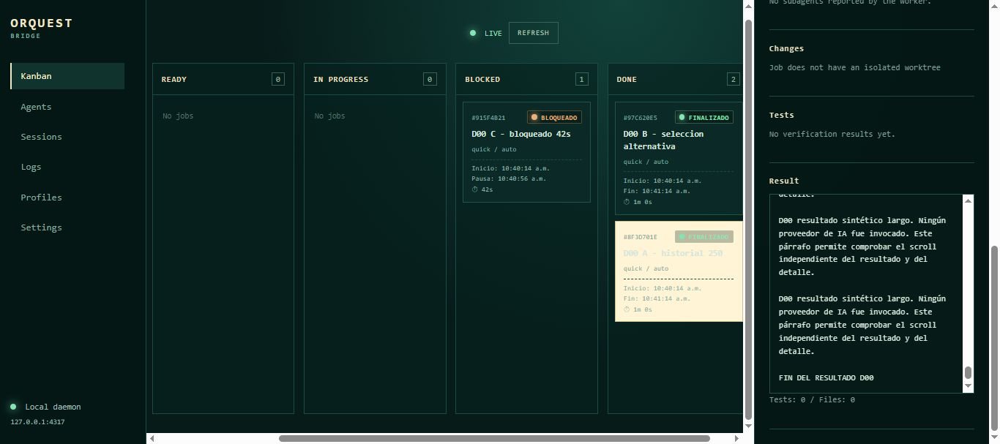

# DASHBOARD-SCROLL-01 — implementado y verificado

Fecha de ejecución: 2026-10-09. Estado del traspaso: documentación/evidencia
conservadas; no se repitió el recorrido durante la organización documental.

## Alcance y archivos

Petición: scroll propio para el panel lateral de detalle y otro para Result.
Se acotó el layout de escritorio al viewport y se usó CSS nativo, sin librerías
de scroll ni cambios de contratos/daemon/MCP.

- `apps/dashboard/src/styles.css`: alturas, overflow independiente, límites
  responsive, saltos de línea y foco visible.
- `apps/dashboard/src/app.tsx`: nombres accesibles, foco por teclado y región
  Result que se reinicia al cambiar de tarjeta.
- `apps/dashboard/fixtures/d00-acceptance.ts`: resultado sintético largo en A
  para reproducir el defecto sin workers reales.

## Evidencia observada

Chrome conectado, fixture aislado en 4417/4418; base nueva, sin usar datos ni
servicios personales. Las mediciones corresponden a ese viewport/fixture.

| Caso | Resultado observado |
| --- | --- |
| Escritorio 1366×607 | Página de 607 px; detalle con contenido de 1372 px; Result de 271 px con contenido de 8644 px. |
| Teclado: final de Result | Control+End alcanzó scrollTop 8373, igual a scrollHeight − clientHeight; aparece FIN DEL RESULTADO D00. Página en scrollTop 0 y tablero sin movimiento adicional. |
| Panel independiente | ScrollTop del detalle 765; Result desplazable dentro del panel, sin alargar la página. |
| Pantalla 390×844 | Detalle de 590 px, contenido 1479; Result de 378 px, contenido 7211. Accesible por teclado; página puede desplazarse para llegar al panel. |
| Pantalla 900×700 | Detalle de 489 px con contenido 1414; navegación acotada al viewport. |



La captura se copió sin modificar desde `.orquest/dashboard-scroll-desktop.jpg`
a esta ruta documental para acompañar al traspaso. No hay capturas antes/móvil
conservadas ni se afirma que se tomaron. El reinicio del scroll al cambiar tarjeta
está implementado con `key={selected.id}`; no se registró una prueba visual
separada de ese comportamiento. No confundir implementación con evidencia.

## Verificación y cierre

```text
npm.cmd run typecheck                            -> exit 0
npm.cmd run lint                                 -> exit 0
npm.cmd run build --workspace=@orquest/dashboard -> exit 0
npm.cmd test                                    -> exit 0; 135 pruebas / 15 archivos
git diff --check                                -> exit 0
```

Se cerraron la pestaña y los dos procesos propios de prueba; los puertos
4417/4418 quedaron sin listeners y el viewport se restauró. Datos sintéticos
conservados en `.orquest/`; no se ejecutó Antigravity ni se cambió autenticación.

## Pendientes y relevo

No se acepta D00 completo: quedan V01–V08. Tampoco se implementaron chat,
continuidad UI, siete tarjetas por columna ni Profiles dinámicos. Retomar
[D00](D00.md) con [la metodología visual](../visual-validation.md).
El ajuste acotado de scroll debe conservarse; D11 podrá evolucionar Result a
extracto + enlace al chat cuando ese chat exista.
